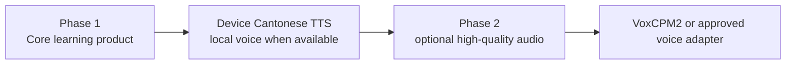

# DADLINGO

Public evaluation build of a Cantonese-first Traditional Chinese literacy game.

## Current build

The live site is a full assessment hub with four clearly separated surfaces:

- `full-game.html` — the current best full work copy: 920 characters, 100
  lessons, eight question types, progress export/import and Manga Companion.
  Its tester control can open any lesson directly, and it uses a separate
  review storage key so testing does not overwrite Muse-original progress.
- `muse-original.html` — checksum-identical Meta Muse source for comparison.
- `new-lessons-review.html` — 12 authored beyond-920 drafts covering 50
  proposed first-teach characters. These are editorial review material, not
  learner-ready lessons.
- `e03.html` — the newer learner-facing vertical-slice experiment, with a
  persistent stage-jump control for remote review.

The wider 3,171-character ambition is not presented as complete. Of the 2,251
characters beyond the existing 920, 50 are represented in the 12 authored
drafts and the remaining 2,201 currently have mechanical allocation only.

No page uses analytics, an account, a network API, or learner-data upload.

## Audio phases

Phase 1 uses only a Cantonese voice available on the learner's device and must
remain usable without audio. It never falls back to Mandarin. Phase 2 may add an
optional higher-quality male/female voice path after pronunciation, rights and
device integration pass review. E03 intentionally shows audio as unavailable
because its voice assets have not passed that later gate.

## Rights

Copyright © 2026 Alex. Public evaluation only. No redistribution license is
granted by this repository at this stage.
